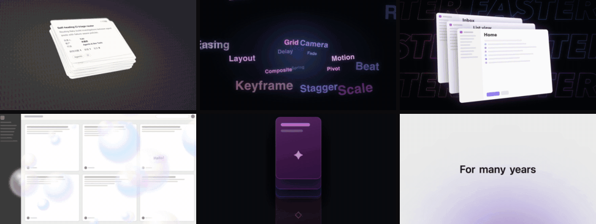

<div align="center">


# Motion Library

### 给视频开发用的动效库

**每个动效都有配方、源码和样片。看样片、搜用途、复制卡名，让 agent 接进你的视频工程。**

[](video-shotcraft-cards/动效卡片目录.md)
[](video-shotcraft-cards/打开动效画廊.html)
[](https://www.remotion.dev/)
[](.agent/skills/motion-library/SKILL.md)
[](video-shotcraft-cards/LICENSE)

**[快速开始](#-快速开始) · [动效分类](#️-动效分类) · [命令行工具](#️-命令行工具) · [开发文档](#-开发文档)**

<br>

<a href="video-shotcraft-cards/打开动效画廊.html"></a>

</div>

## ❤️ 赞助商

<table>
<tr>
<td width="140" align="center"><a href="https://hrouter.net/"></a></td>
<td>
感谢 <a href="https://hrouter.net/"><b>HRouter</b></a> 赞助本项目！HRouter 是 AI 编程模型路由，一把 API Key 就能接 Claude、GPT、Gemini 和 Grok。按量计费，余额实时到账，用量可查，可以接入 Claude Code、Codex 和 Cherry Studio。
<br><br>
官网：<a href="https://hrouter.net/"><b>hrouter.net</b></a>
</td>
</tr>
</table>

## ✨ 为什么用它

<table>
<tr>
<td width="33%" valign="top">

**🎬 先看效果**

离线画廊可以搜索、筛选和全屏播放样片，不用装依赖，也不用启动服务。

</td>
<td width="33%" valign="top">

**📐 配方讲透**

每张卡都写清意图、参数表和已知坑，换文案、换素材时知道该调哪里。

</td>
<td width="33%" valign="top">

**🤖 agent 直接接入**

内置 skill 能按需求选卡，读准确的源码，并把动效和依赖一起接进工程。

</td>
</tr>
</table>

## 🚀 快速开始

### 1. 浏览动效

```bash
git clone https://github.com/honestTai/motion-library.git
```

打开 [`video-shotcraft-cards/打开动效画廊.html`](video-shotcraft-cards/打开动效画廊.html)。也可以直接看[中文目录](video-shotcraft-cards/动效卡片目录.md)。

### 2. 安装 skill

用软链接安装，仓库更新后 skill 也会同步。在仓库根目录运行：

```bash
ln -s "$PWD/.agent/skills/motion-library" ~/.claude/skills/motion-library
```

```bash
ln -s "$PWD/.agent/skills/motion-library" ~/.codex/skills/motion-library
```

### 3. 开一个新会话，描述需求

```text
这一段讲三个步骤：准备素材、安排画面、检查导出。
用动效库选一个合适的动效，接进当前的 Remotion 工程。
```

## 🎞️ 动效分类

| 分类 | 卡片数 | 代表动效 |
|:---|:---:|:---|
| 开场与品牌 | 10 | [`spotlight-hero-card`](video-shotcraft-cards/references/shots/opening/spotlight-hero-card.md) |
| 文字与字卡 | 25 | [`blur-slide`](video-shotcraft-cards/references/shots/typography/blur-slide.md) |
| 界面登场与陈列 | 27 | [`card-stack`](video-shotcraft-cards/references/shots/ui-entrance/card-stack.md) |
| 运镜与空间 | 10 | [`crash-zoom-punch`](video-shotcraft-cards/references/shots/camera/crash-zoom-punch.md) |
| 数据与指标 | 11 | [`odometer-digit-roll`](video-shotcraft-cards/references/shots/data/odometer-digit-roll.md) |
| 交互与功能演示 | 15 | [`ai-stream-response`](video-shotcraft-cards/references/shots/interaction/ai-stream-response.md) |
| 转场 | 19 | [`shot-transitions`](video-shotcraft-cards/references/shots/transition/shot-transitions.md) |
| 节奏与蒙太奇 | 11 | [`beat-cut-moves`](video-shotcraft-cards/references/shots/rhythm/beat-cut-moves.md) |
| 光效与强调 | 17 | [`impact-feedback`](video-shotcraft-cards/references/shots/effects/impact-feedback.md) |
| 收尾 | 7 | [`outro-group-photo-launch`](video-shotcraft-cards/references/shots/outro/outro-group-photo-launch.md) |

## 🛠️ 命令行工具

只需要 Python 3。每次运行都实时扫描库，没有索引要维护。

```bash
python3 .agent/skills/motion-library/scripts/motion_lib.py search "数字跳动 强调增长"
```

```bash
python3 .agent/skills/motion-library/scripts/motion_lib.py show card-stack
```

```bash
python3 .agent/skills/motion-library/scripts/motion_lib.py copy card-stack --to /path/to/remotion-project --dry-run
```

| 命令 | 作用 |
|:---|:---|
| `stats` | 查看库的当前规模 |
| `search` | 用中文或英文描述找卡 |
| `show` | 列出配方、源码、依赖、资源和样片路径 |
| `copy` | 把动效和依赖复制进工程，import 不用改，文件有冲突时会停下 |
| `doctor` | 校验配方、源码、依赖、样片和画廊索引是否一致 |

## 📚 开发文档

示例基于 Remotion，默认 30fps、1920×1080。依赖版本见 [`upstream-render-dependencies.json`](video-shotcraft-cards/demos/upstream-render-dependencies.json)。

- [开发约定](.agent/skills/motion-library/references/development.md)：demo 类型、换中文、换画幅、移植到非 Remotion 工程
- [更新动效库](.agent/skills/motion-library/references/updating.md)：新增卡片、导入新版本、同步画廊
- [源码说明](video-shotcraft-cards/demos/README.md)：共享件、纹理和 ClipCard 的用法。这份说明来自上游，其中提到的 `template/` 和测试脚本不在本仓库中

<details>
<summary><b>目录结构</b></summary>

```text
.agent/skills/motion-library/   agent skill 和命令行工具
docs/assets/                    README 图片
video-shotcraft-cards/
├── references/shots/           配方卡，按分类存放
├── demos/                      Remotion 实现、共享件和纹理
├── assets/lib/                 可复用组件
├── gallery/                    离线画廊和样片
├── 动效卡片目录.md / .csv       中文目录
└── 打开动效画廊.html            画廊入口
```

</details>

## 📄 来源与许可

动效内容提取自 [Vincentwei1021/video-shotcraft](https://github.com/Vincentwei1021/video-shotcraft)，按 [Apache License 2.0](video-shotcraft-cards/LICENSE) 分发。

本仓库相对上游的改动：提取动效卡片部分，新增并重新设计离线画廊，新增中文目录、`motion-library` skill 和命令行工具，并删除了上游站点相关文件。这个仓库不含完整宣传片模板和音乐音效库。

部分卡片的手法研究自公开发布的作品，实现均为重写，来源和边界见 [ATTRIBUTION.md](video-shotcraft-cards/references/shots/ATTRIBUTION.md)。使用时不要复刻原作的画面、文案或品牌元素。

---

<div align="center">

Made by **honestTai**

[GitHub](https://github.com/honestTai) · [X](https://x.com/Honestn1w) · [抖音](https://v.douyin.com/EYqgXb7y_k8/)

</div>
