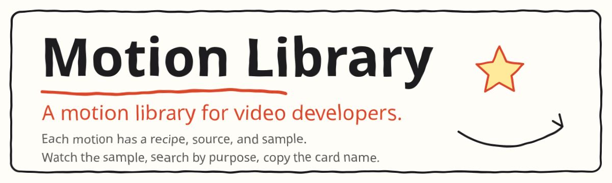

<div align="center">

<picture>
  <source media="(prefers-color-scheme: dark)" srcset="docs/assets/hero.svg">
  
</picture>

### A motion library for video developers

**Each motion has a recipe, source, and sample. Watch the sample, search by purpose, copy the card name, and let an agent wire it into your video project.**

[](video-shotcraft-cards/动效卡片目录.md)
[](video-shotcraft-cards/打开动效画廊.html)
[](https://www.remotion.dev/)
[](.agent/skills/motion-library/SKILL.md)
[](video-shotcraft-cards/LICENSE)

**[Quick start](#-quick-start) · [Features](#-features) · [Docs](#-docs) · [License](#-license)**

**English** · [简体中文](README.zh-CN.md)

</div>

## ❤️ Sponsor

| Sponsor | What it is |
| :--- | :--- |
| [](https://hrouter.net/home) | **[HRouter](https://hrouter.net/home)**: model access, API key management, and usage tracking for AI coding and application development. Also operated by the maintainer. |

## 🚀 Quick start

### 1. Browse motions

```bash
git clone https://github.com/honestTai/motion-library.git
```

Open [`video-shotcraft-cards/打开动效画廊.html`](video-shotcraft-cards/打开动效画廊.html). You can also read the [Chinese catalog](video-shotcraft-cards/动效卡片目录.md).

### 2. Install the skill

Install with a symlink so the skill stays in sync when the repository updates. Run from the repository root:

```bash
ln -s "$PWD/.agent/skills/motion-library" ~/.claude/skills/motion-library
```

```bash
ln -s "$PWD/.agent/skills/motion-library" ~/.codex/skills/motion-library
```

### 3. Start a new session and describe the need

```text
这一段讲三个步骤：准备素材、安排画面、检查导出。
用动效库选一个合适的动效，接进当前的 Remotion 工程。
```

## ✨ Features

| Category | Cards | Example |
| :--- | :---: | :--- |
| 开场与品牌 | 10 | [`spotlight-hero-card`](video-shotcraft-cards/references/shots/opening/spotlight-hero-card.md) |
| 文字与字卡 | 25 | [`blur-slide`](video-shotcraft-cards/references/shots/typography/blur-slide.md) |
| 界面登场与陈列 | 27 | [`card-stack`](video-shotcraft-cards/references/shots/ui-entrance/card-stack.md) |
| 运镜与空间 | 10 | [`crash-zoom-punch`](video-shotcraft-cards/references/shots/camera/crash-zoom-punch.md) |
| 数据与指标 | 11 | [`odometer-digit-roll`](video-shotcraft-cards/references/shots/data/odometer-digit-roll.md) |
| 交互与功能演示 | 15 | [`ai-stream-response`](video-shotcraft-cards/references/shots/interaction/ai-stream-response.md) |
| 转场 | 19 | [`shot-transitions`](video-shotcraft-cards/references/shots/transition/shot-transitions.md) |
| 节奏与蒙太奇 | 11 | [`beat-cut-moves`](video-shotcraft-cards/references/shots/rhythm/beat-cut-moves.md) |
| 光效与强调 | 17 | [`impact-feedback`](video-shotcraft-cards/references/shots/effects/impact-feedback.md) |
| 收尾 | 7 | [`outro-group-photo-launch`](video-shotcraft-cards/references/shots/outro/outro-group-photo-launch.md) |

## 📚 Docs

Examples are based on Remotion, 30fps and 1920×1080 by default. Dependency versions are in [`upstream-render-dependencies.json`](video-shotcraft-cards/demos/upstream-render-dependencies.json).

- [Development conventions](.agent/skills/motion-library/references/development.md): demo types, swapping in Chinese copy, changing the frame size, and porting to a non-Remotion project
- [Updating the library](.agent/skills/motion-library/references/updating.md): add a card, import a new version, and sync the gallery
- [Source notes](video-shotcraft-cards/demos/README.md): shared pieces, textures, and ClipCard. These notes come from upstream; the `template/` directory and test scripts they mention are not in this repository

## 📄 License

Motion content is extracted from [Vincentwei1021/video-shotcraft](https://github.com/Vincentwei1021/video-shotcraft) and distributed under the [Apache License 2.0](video-shotcraft-cards/LICENSE).

Changes in this repository relative to upstream: the motion-card portion is extracted, the offline gallery is added and redesigned, a Chinese catalog, the `motion-library` skill, and a command-line tool are added, and upstream site files are removed. This repository does not include the full promo-video template or the music and sound-effects library.

Some card techniques were studied from publicly released works. The implementations are rewrites. Sources and boundaries are in [ATTRIBUTION.md](video-shotcraft-cards/references/shots/ATTRIBUTION.md). Do not reproduce the original picture, copy, or brand elements.

## 📈 Star history

<a href="https://www.star-history.com/#honestTai/motion-library&Date">
  <picture>
    <source media="(prefers-color-scheme: dark)" srcset="https://api.star-history.com/svg?repos=honestTai/motion-library&type=Date&theme=dark">
    
  </picture>
</a>

---

<div align="center">

Made by **[honestTai](https://github.com/honestTai)** · [HRouter](https://hrouter.net/home) · [More projects](https://github.com/honestTai)

</div>
